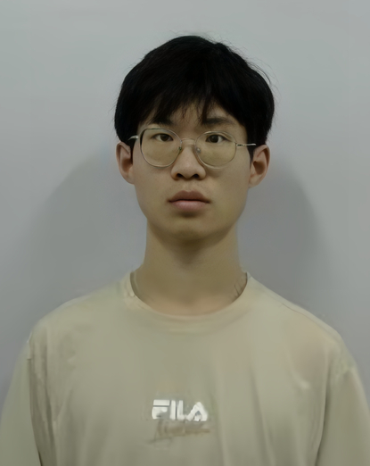

<section class="ah-hero" aria-labelledby="intro-heading">

AI research · University of Florida
<h1 id="intro-heading">Yujing Ju</h1>
Learning, reasoning, and reliable agents.

I am a Research Assistant at the <a href="https://www.ufl.edu/">University of Florida</a>, working with <a href="https://hobi.med.ufl.edu/profile/liu-mei/">Prof. Mei Liu</a> on large language models, reinforcement learning, and multi-agent systems.

My work connects model post-training with long-horizon reasoning, tool use, and rigorous evaluation.

<a class="ah-primary" href="/cv/">Curriculum vitae ↗</a><a href="https://github.com/juyujing">GitHub ↗</a><a href="https://www.linkedin.com/in/juyujing/">LinkedIn ↗</a><a href="mailto:yujingju@ufl.edu">Email ↗</a>

<figure class="ah-photo"><figcaption>YUJING JU · UNIVERSITY OF FLORIDA</figcaption></figure>
</section>

<strong>Model post-training</strong>
Reinforcement learning and verifiable reasoning for language models.

<strong>Long-horizon agents</strong>
Multi-step planning, tool use, and agent trajectories.

<strong>Reliable evaluation</strong>
Privacy, domain reasoning, and repeatable model assessment.

<section class="ah-section"><header>
01 / Research & engineering
<h2>Selected work</h2></header>

<article class="ah-work">
Pharmaron · Algorithm Engineer Intern<time>Oct 2026–present</time>
<h3>Scaling laws for domain-specialized LLMs</h3>
Run small-model experiments to extrapolate large-scale training performance and guide model size, training-token budgets, and compute allocation. Research targets competitive general-language benchmarks and expert-level pharmaceutical capabilities.

Investigate Engram-augmented MoE scaling laws across active expert parameters, conditional-memory capacity, and training data. Study constant-time n-gram lookup to expand knowledge capacity with limited added computation and preserve neural capacity for reasoning.

Compute–memory allocation · Megatron-LM · DeepSpeed · Triton · Training sharding
</article>
<article class="ah-work">
University of Florida · Research Assistant<time>Aug 2025–present</time>
<h3>LLM privacy and evaluation</h3>
Building privacy and ICD-coding benchmarks with 31,080 QA examples, 4,440 patient-level samples, and 1,860 valid ICD labels. Developing offline data generation and distributed training and evaluation workflows on the HiPerGator B200 cluster.

Privacy-preserving fine-tuning · Model evaluation · Distributed systems
</article>
<article class="ah-work">
Hithink RoyalFlush · Algorithm Engineer Intern<time>Aug–Oct 2026</time>
<h3>AIME Investment Assistant</h3>
Applied GRPO-based post-training to U.S. equity selection and investment recommendations for AInvest. Developed agent trajectories, long-horizon market analysis, quantitative strategies, and paper-trading simulations.

Adapted time-series reasoning, verifiable forecast actions, and explainable stock selection from VTA, StockR1, AlphaQuanter, SEP, and GRPO Financial Analyst.

GRPO · VeRL · DeepSpeed · Megatron-LM · Slime
</article>
<article class="ah-work">
Heriot-Watt University · Graph learning<time>2024–2025</time>
<h3>Learning from asymmetric relationships</h3>
Developed asymmetric graph convolution operators and investigated directed graph structures for recommendation, preserving citation direction and heterogeneous author–paper interactions.
</article>

</section>
<section class="ah-section"><header>
02 / Open source
<h2>Selected projects</h2></header>
<a class="ah-project" href="https://github.com/juyujing/Graduation-Project"><h3>Directed recommendation</h3>
Directed and heterogeneous graph modeling for academic paper recommendation.
View repository ↗</a><a class="ah-project" href="https://github.com/juyujing/HyperGCN"><h3>Hypergraph recommendation</h3>
Higher-order interactions for joint item and participant prediction.
View repository ↗</a><a class="ah-project" href="https://github.com/juyujing/GrOVe"><h3>Graph modeling library</h3>
Open-source tools for graph-based mathematical modeling.
View repository ↗</a><a class="ah-project" href="https://github.com/juyujing/Capturer"><h3>Visually guided robotics</h3>
A biomimetic hexapod integrating object recognition and motion planning.
View repository ↗</a>
</section>
<section class="ah-section"><header>
03 / Background
<h2>Education & experience</h2></header>

<strong>University of Florida</strong>
PhD program in Biological and Medical Sciences · Master-en-route Aug 2025–Jan 2027 (expected) · AI and large language models

<strong>Heriot-Watt University</strong>
BEng in Robotics · First Class Honours Sep 2021–May 2025

<strong>Pharmaron</strong>
Algorithm Engineer Intern · Oct 2026–present

</section>
<section class="ah-contact">
<h2>Research & collaboration</h2>
Language models, reinforcement learning, and agent systems.

<a href="mailto:yujingju@ufl.edu">yujingju@ufl.edu ↗</a></section>

